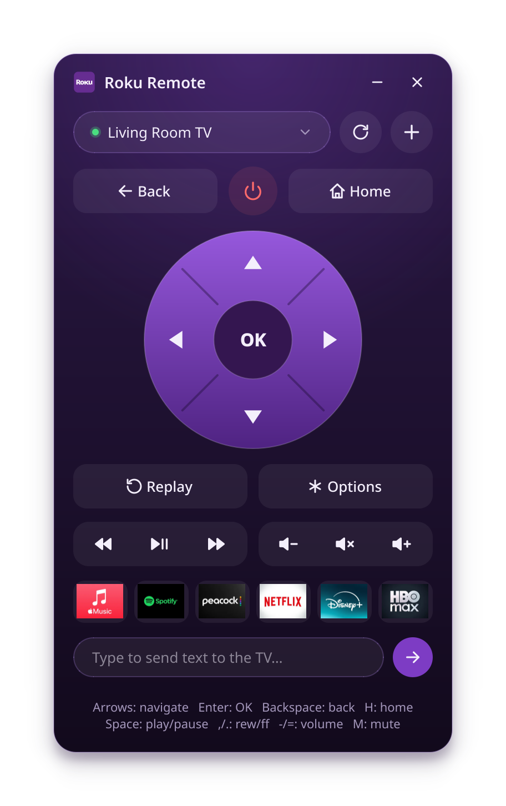

# Roku Remote for Linux and Windows

Control your Roku TV or Roku streaming player from your computer. Roku Remote is a free, open-source desktop remote control app for Linux and Windows PCs. It talks to your Roku directly over your home network, so you don't need a phone, a Roku account, or an internet connection.

[](https://github.com/averagenative/roku-remote/releases/latest)
[](https://github.com/averagenative/roku-remote/releases)
[](LICENSE)

<p align="center">
  
</p>

**[Download Roku Remote for Linux (AppImage)](https://github.com/averagenative/roku-remote/releases/latest/download/roku-remote-x86_64.AppImage)** | **[Download Roku Remote for Windows (.exe)](https://github.com/averagenative/roku-remote/releases/latest/download/roku-remote-windows-x86_64.exe)** | [All releases](https://github.com/averagenative/roku-remote/releases)

## Features

Roku Remote gives you the full Roku remote on your desktop, plus a few things a handheld remote can't do:

- **Every Roku device:** works with Roku TVs from brands such as TCL, Hisense, onn., and Sharp, and with Roku Express, Streaming Stick, and Ultra players.
- **Automatic discovery:** finds the Rokus on your network, or you can add one by IP address.
- **Full remote layout:** D-pad and OK, Back, Home, power, Instant Replay, Options, rewind, play and pause, fast-forward, volume, and mute.
- **Keyboard control:** use your PC keyboard as a Roku remote, with arrow keys, Enter, Backspace, and media shortcuts.
- **Text input:** type into Roku search boxes and sign-in screens from your keyboard instead of an on-screen keyboard.
- **Channel shortcuts:** launch your installed channels with one click, shown with their real icons.
- **Reliable reconnect:** remembers each TV by serial number, finds it again when your router gives it a different IP address, and reconnects on its own when the TV comes back online.
- **Local and private:** everything stays on your local network. No account, no cloud service, no ads, and no tracking.
- **Portable:** a single AppImage on Linux and a single `.exe` on Windows, with no installer.

## Install Roku Remote

Download the file for your system from the [releases page](https://github.com/averagenative/roku-remote/releases/latest). Your computer and your Roku must be on the same network.

### Linux

The AppImage runs on 64-bit Linux distributions with glibc 2.28 or newer, which includes Ubuntu 20.04 and later, Debian 10 and later, Linux Mint 20 and later, Fedora, and RHEL 8 and later. On older systems, [run Roku Remote from source](#run-from-source).

1. Download `roku-remote-x86_64.AppImage`.
2. Make it executable:

   ```
   chmod +x roku-remote-x86_64.AppImage
   ```

3. Run it:

   ```
   ./roku-remote-x86_64.AppImage
   ```

### Windows

Roku Remote runs on 64-bit Windows 10 and Windows 11.

1. Download `roku-remote-windows-x86_64.exe`.
2. Run it. If Windows SmartScreen shows "Windows protected your PC", click **More info**, then **Run anyway**. SmartScreen warns about the `.exe` because it isn't code-signed.

## Allow network control on your Roku

Many Roku TVs ship with network control set to *Limited*, which blocks most commands from apps like this one. If buttons don't work, or the app says the TV blocks network control, change this setting on each Roku you want to control:

1. On the Roku, open **Settings** > **System** > **Advanced system settings** > **Control by mobile apps**.
2. Set **Network access** to **Default**.

## Use Roku Remote

When Roku Remote starts, it reconnects to the TV you used last. To pick a different Roku, use the device list at the top of the window. The dot next to the device name shows the connection: green means connected, amber means connecting or searching, and red means the TV can't be found. The status line at the bottom of the window describes the connection in words.

To search the network again, click **Discover devices** (the refresh button). To add a Roku by its IP address, click **Add device by IP** (the plus button).

The window has no system title bar. To move it, drag any empty area.

### Keyboard shortcuts

You can control your Roku from your keyboard with these shortcuts:

| Key | Action |
| --- | --- |
| Arrow keys | Navigate |
| Enter | OK |
| Backspace, Esc | Back |
| H | Home |
| Space | Play or pause |
| Comma, Period | Rewind, fast-forward |
| Minus, Equals | Volume down, volume up |
| M | Mute |
| Ctrl+Q, Ctrl+W | Close Roku Remote |

The shortcuts pause while you type in the text box. To return to remote control, press Esc or click anywhere outside the text box.

## Troubleshooting

### Roku Remote can't find my Roku

Check the following:

- Your computer and your Roku are on the same network. Guest Wi-Fi networks and some VPNs keep devices apart.
- Your firewall allows local network traffic. Discovery uses SSDP (UDP port 1900), and control uses HTTP on port 8060.

If discovery still doesn't find your Roku, add it by IP address. On the Roku, find the address in **Settings** > **Network** > **About**. Then click **Add device by IP** in Roku Remote and enter it.

### Buttons don't respond, or the app says the TV blocks network control

Your Roku is in *Limited* mode. To fix it, see [Allow network control on your Roku](#allow-network-control-on-your-roku).

### The power button doesn't turn my TV on

A Roku TV can only turn on from the network if it keeps its network connection in standby. On the TV, turn on **Fast TV start** in **Settings** > **System** > **Power**.

### Where is the log file?

Roku Remote writes a debug log of every request to your Roku, every connection change, and any crash:

- Linux: `~/.local/state/roku-remote/roku-remote.log`
- Windows: `%LOCALAPPDATA%\roku-remote\roku-remote.log`

The log rotates at 2 MB and keeps four old files. Text you send to the TV is never logged: literal keypresses appear as `Lit_*`.

## How it works

Roku Remote uses the Roku [External Control Protocol (ECP)](https://developer.roku.com/docs/developer-program/dev-tools/external-control-api.md), the local HTTP interface that Roku's own mobile app uses for its remote. It finds devices with SSDP and sends key presses, app launches, and text to port 8060 on the Roku. All of this lives in `roku_remote/ecp.py`.

Devices are saved by serial number in `~/.config/roku-remote/`. Roku Remote checks the selected TV every 30 seconds. If the TV stops answering, or a different Roku answers at its address, the app rescans the network and reconnects. While the TV can't be found, it retries every 10 seconds for the first minute and then once a minute. Pressing a button while it's searching triggers an immediate rescan.

## Build from source

### Run from source

You need Python 3.10 or newer.

```
git clone https://github.com/averagenative/roku-remote.git
cd roku-remote
python3 -m venv .venv
.venv/bin/pip install -r requirements.txt
.venv/bin/python -m roku_remote
```

### Build the Linux AppImage

The build runs inside an AlmaLinux 8 container so that the AppImage works on systems as old as glibc 2.28. You need [Distrobox](https://distrobox.it/) and Podman.

```
./build-appimage.sh
```

The script produces `roku-remote-x86_64.AppImage` with PyInstaller and appimagetool. On the first run, it creates a container named `roku-remote-build` and installs the build tools in it, which takes a few minutes. The script prints the oldest glibc version that the AppImage needs.

To build on your own system instead, which is faster but produces an AppImage that only runs on systems as new as yours, run `NATIVE=1 ./build-appimage.sh` after you install PyInstaller in `.venv`.

### Build the Windows executable

```
./build-windows.sh
```

The script builds `roku-remote-windows-x86_64.exe` on Linux with Wine and the Windows build of Python, so you don't need a Windows computer.

### Add Roku Remote to your app menu on Linux

```
./install-desktop.sh
```

The script copies the AppImage to `~/Applications/`, installs the icon, and registers `~/.local/share/applications/roku-remote.desktop`, so GNOME search and other app launchers find Roku Remote. Run it again after each rebuild.

### Regenerate the screenshots

```
.venv/bin/python assets/gen_screenshot.py ROKU_IP
```

The script writes `docs/screenshot.png` and `docs/social-preview.png`, the image GitHub shows when someone shares a link to the repository. Replace `ROKU_IP` with the address of a Roku on your network to fill the channel row with its app icons. Both images always show a placeholder device name.

## License

Roku Remote is released under the [MIT License](LICENSE).

Roku Remote is an independent project. It isn't affiliated with, endorsed by, or sponsored by Roku, Inc. Roku and the Roku logo are trademarks of Roku, Inc.
